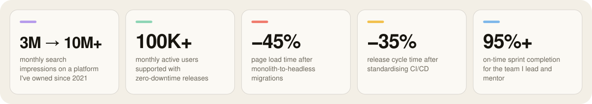
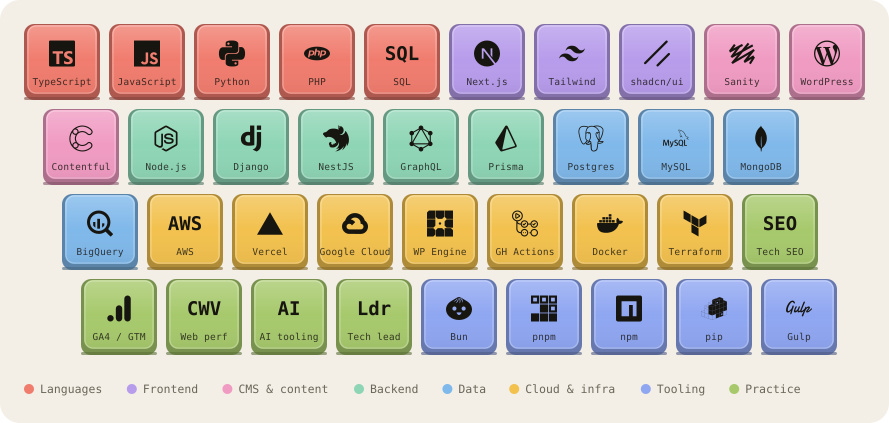

<picture>
  <source media="(prefers-color-scheme: dark)" srcset="assets/banner-dark.svg">
  
</picture>

**Lead full-stack engineer, Thane / Mumbai.** Napkin sketch or a platform you've outgrown, I've shipped both. One grew from 3M to 10M searches a month with zero downtime.

- **Idea → MVP.** Discovery workshop, scope, data model, first release, first users. A forecasting product went from a question in a client meeting to a paid pilot in one quarter.
- **MVP → scale.** Headless architecture (Sanity, WordPress, Contentful behind Next.js), ISR that editors understand, Core Web Vitals in the green, SEO and tracking treated as engineering requirements.
- **Stack is never the blocker.** PHP to Python to TypeScript, CMS to cloud to data. I pick tools after understanding the problem, and the unfamiliar one is the one I'll volunteer for.

> This account is where my personal projects live. The work account is [@smehboobaxioned](https://github.com/smehboobaxioned).

## About

I'm a lead full-stack engineer based in Thane, just outside Mumbai, with eight years of experience delivering high-impact digital products, all of it at Axioned, where I grew from junior engineer to the technical lead for an enterprise delivery team. My career is defined by long-term ownership: evolving platforms from their first architecture to supporting millions of users.

I work as the technical bridge between business and execution. That means sitting with marketing, design and analytics teams to make sure what we build is optimised for SEO, tracking and conversion, then translating that into roadmaps, RFCs and code. My specialism is headless architecture, Sanity and WordPress behind Next.js, but I'm equally at home in Django, Node and NestJS services, and in the AWS and GCP infrastructure that runs them.

I believe in problem-solving over syntax and culture over raw output. My experience is deliberately diversified because the technology has never been the blocker. Understanding the problem is, and that's the part I enjoy most. I use AI tooling daily for prototyping and code optimisation, and I'm deliberately careful with it around sensitive data.

| | |
| --- | --- |
| **Based in** | Thane / Mumbai, India · IST (UTC+5:30) |
| **Currently** | Lead Full-Stack Engineer, Axioned (2018 → now) |
| **Specialism** | Headless · Sanity · Next.js |
| **Education** | B.E. Computer Engineering |
| **Speaks** | English, Hindi |
| **Open to** | Senior IC and tech lead roles |

> "Mehboob is an extremely valuable person to have in your network. He has an in-depth understanding of various technologies, manages all the work very effectively and has very strong problem-solving skills. He is an asset to any company."
>
> — Prajakta Dhuri, Senior UX/UI Designer, worked with me on the same team

## Experience

**Lead Full-Stack Engineer · Axioned · 2023 → present**
Technical lead for an enterprise delivery team that reports to me: architecture, sprint execution, mentoring and code quality for several concurrent client platforms, while staying hands-on most of the week.
- Taken client ideas from discovery workshop to shipped MVP, then grown them into platforms with real traffic.
- Architected 5+ migrations from monolithic CMS platforms to Next.js with Sanity or Contentful: page loads down ~45%, Core Web Vitals at 95+.
- Designed B2B backend modules in Django and NestJS handling high-concurrency transactions and third-party integrations (HubSpot, payment and analytics APIs).
- Delivered a Python forecasting proof of concept (Pandas, scikit-learn) for an advertising client, projecting product performance from campaign data.
- Standardised CI/CD with GitHub Actions, Docker and Terraform across AWS and GCP; release cycles ~35% shorter, sprint on-time completion at 95%+.

**Senior Software Engineer · Axioned · 2021 → 2023**
Owner of a publishing platform serving 100K+ monthly active users; the bridge between engineering, marketing and analytics.
- Grew a B2B media platform from 3M to 10M+ monthly search impressions through structured data, performance and crawlability work.
- Built headless WordPress frontends with React and WPGraphQL; GA4, Tag Manager and Search Console as first-class engineering requirements.
- Introduced Dockerised environments and GitHub Actions pipelines; zero-downtime releases became the default.

**Junior Software Engineer · Axioned · 2018 → 2021**
Responsive sites and custom WordPress platforms with PHP, JavaScript, SASS and the REST API; Google Maps, Mapbox, YouTube, Twitter and HubSpot integrations; hosting, DNS, SSL and servers on AWS EC2, S3 and CloudFront.

Full timeline and a printable version at [mehboobshaikh.com/resume](https://mehboobshaikh.com/resume/).

## Outcomes

<picture>
  <source media="(prefers-color-scheme: dark)" srcset="assets/outcomes-dark.svg">
  
</picture>

## Lessons from the field

- **Editors decide whether a headless migration succeeds.** The frontend is the easy part. If the content model doesn't match how the marketing team thinks, they'll route around it. Model with them, not for them.
- **SEO breaks silently during re-platforms.** Rankings don't drop on launch day; they drop six weeks later. Redirect maps, canonical tags and structured data need the same test coverage as checkout.
- **A forecasting model is only as good as its joins.** Most of the forecasting POC was reconciling campaign, product and spend data from three systems. The model was the last 10%.
- **ISR is a conversation, not a config value.** Revalidation windows are a product decision. Explain the trade-off to editors once and you'll never get the "my change isn't live" ticket again.
- **One pipeline beats eight clever ones.** Standardising CI/CD across client repos was unglamorous and cut release time by a third. Consistency is a feature your future self ships.

## Ideas I keep coming back to

<picture>
  <source media="(prefers-color-scheme: dark)" srcset="assets/ideas-dark.svg">
  
</picture>

## Toolkit

<picture>
  <source media="(prefers-color-scheme: dark)" srcset="assets/stack-dark.svg">
  
</picture>

Sanity behind Next.js is the specialism. WordPress is the one I know where every body is buried. Bun is the default for anything new, this README's artwork included.

## On the side

Free, private tools I made for myself and put into production anyway. No ads, no sign-up, no trackers; your data stays in your browser.

<table>
  <tr>
    <td width="72" valign="top"></td>
    <td valign="top">
      <b><a href="https://songs.mehboobshaikh.com">Dil Ki Cassette</a></b> · <code>songs.mehboobshaikh.com</code> 
      A calm Bollywood listening room behind a rainy window. 871 hand-picked Hindi film songs from 1988 to 2024, played only from the labels' official YouTube uploads. Seven moods reshape the songs, the weather and the player's colours. Turn any YouTube or Spotify playlist into a mixtape, play Antakshari, share a song at the exact second, or dedicate a cassette with a handwritten note. 
      Next.js · TypeScript · WebGL · YouTube IFrame API · Claude API · Cloudflare Pages
    </td>
  </tr>
  <tr>
    <td width="72" valign="top"></td>
    <td valign="top">
      <b><a href="https://diet.mehboobshaikh.com">Subscription Diet</a></b> · <code>diet.mehboobshaikh.com</code> 
      See what your subscriptions really cost in a year, and cut the ones you don't use. Every plan becomes a dark-metal card in a wallet: 250+ services with real logos and typical prices, each showing its true yearly cost (₹649 a month reads as ₹7,788 a year). Keep, maybe or cut, a four-week charge calendar, renewal reminders, a ⌘K palette and a shareable savings card. 
      Next.js · TypeScript · Tailwind · Motion · React Aria · Cloudflare Pages
    </td>
  </tr>
  <tr>
    <td width="72" valign="top"></td>
    <td valign="top">
      <b><a href="https://cleanyourtv.mehboobshaikh.com">Clean Your TV</a></b> · <code>cleanyourtv.mehboobshaikh.com</code> 
      A family TV, debloated and given a home screen of its own. Our Sony BRAVIA running Google TV, with 26 bloat packages switched off (never uninstalled) and a launcher of our own: a 3D dock where each app lights the screen in its own colour, a family screen, an offline screensaver, and one script that rebuilds the TV after a factory reset. Built on <a href="https://github.com/Gathin23/cleanyourtv">Gathin's open-source cleanyourtv</a> and not affiliated with it. The site tells the story screen by screen, with a drag-to-compare before and after. 
      Java · Android TV · ADB · Next.js · TypeScript · Tailwind · Cloudflare Pages
    </td>
  </tr>
  <tr>
    <td width="72" valign="top"></td>
    <td valign="top">
      <b><a href="https://mehboob-arcade.vercel.app">Mehboob's Arcade</a></b> · <code>mehboob-arcade.vercel.app</code> 
      A growing library of handcrafted browser games: a wall-and-pawn strategy board, a one-tap physics dodge, a virtual handheld console and a kids' memory game with 277 cards. Vanilla HTML, CSS and JavaScript. No frameworks, no build step, no installs, just play. 
      HTML · CSS · JavaScript · Playwright · Vercel
    </td>
  </tr>
  <tr>
    <td width="72" valign="top"></td>
    <td valign="top">
      <b><a href="https://mehboobshaikh.com">mehboobshaikh.com</a></b> · <code>mehboobshaikh.com</code> 
      My portfolio, as a keyboard. PORTFOLIO is spelled in 3D keycaps and every key opens a section; type on your own keyboard and it answers. Static Next.js on Cloudflare Pages, with a hash-based CSP, JSON-LD, Markdown twins for agents (<code>curl -H "Accept: text/markdown" mehboobshaikh.com</code>) and a Lighthouse score I keep an eye on. 
      Next.js 16 · React 19 · TypeScript · Tailwind v4 · Motion · Bun · Cloudflare Pages
    </td>
  </tr>
  <tr>
    <td width="72" valign="top"></td>
    <td valign="top">
      <b>Quilo</b> · in the lab 
      A quiet notch companion for macOS. What's playing and what just arrived, in the notch, ordered by what you care about. Native Swift inside a Tauri shell; not public yet. 
      Rust · Tauri · Swift · TypeScript
    </td>
  </tr>
</table>

## Lately

- Taking a new client product from discovery to MVP, and leading headless re-platforms to Sanity + Next.js.
- Building most side projects with Claude Code in the loop, and writing down the prompts and workflow that take an idea from an empty folder to live, indexed and showcased.
- Tinkering with AI developer tooling, reading changelogs and launch threads, and running small experiments to see what actually makes the work faster.
- Debloated the family TV over Wi-Fi and built it a launcher of its own, then a site to tell the story: [Clean Your TV](https://cleanyourtv.mehboobshaikh.com).
- Looking for my next senior IC or tech lead role. The stack matters less than the problem; bring me a hard one.

## Say hello

[mehboobshaikh.com](https://mehboobshaikh.com) · [LinkedIn](https://www.linkedin.com/in/mehboob-shaikh-86878b114/) · [Résumé](https://mehboobshaikh.com/resume/) · Thane / Mumbai · IST (UTC+5:30)

Keycaps drawn in SVG by <a href="scripts/build-assets.ts">one Bun script</a>, so they pick up your light or dark theme. Built with love.
